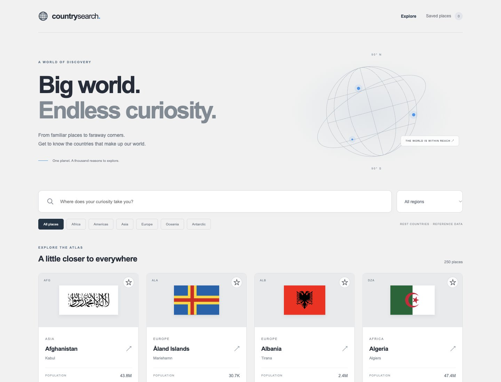

# Country Search

A responsive atlas built with React and Vite, preserving the original gray/white palette, blue accents, and yellow favorites.

[Live demo](https://franxis12.github.io/country_search/)



## Features

- Explore 250 countries and territories without an API key.
- Search country names or capitals, including accent-insensitive matches.
- Filter by region, view details, and load more results.
- Save favorites locally; saved places survive a reload.
- Keyboard-accessible country dialogs, loading/error/empty states, and mobile layouts.

## Data

The legacy REST Countries v3.1 endpoint was retired. This demo uses a bundled, reduced-field copy of the open-source [REST Countries dataset](https://github.com/restcountries/restcountries/blob/bfadee4f951682c29970e53677707bc558e80b74/src/main/resources/countriesV3.1.json), retrieved October 12, 2026. Population and geographic figures are reference data, not live estimates. Countries and dependent territories are both included.

The derived JSON remains under MPL-2.0; see [the data notice](public/data/NOTICE.md) and [license](public/data/LICENSE). Flag images load from the original FlagCDN URLs. To refresh the data, replace the JSON from the upstream source, retain the selected fields and attribution, then rebuild.

## Development

```sh
npm ci
npm run dev
npm run build
npm run lint
```

Vite uses `/country_search/` as its base path. `npm run deploy` builds and updates the existing `gh-pages` publication branch. Development changes belong on `main`.

## Validation

Production build and ESLint pass. Browser checks cover search, region filters, country details, persistent favorites, empty results, and responsive layouts.
